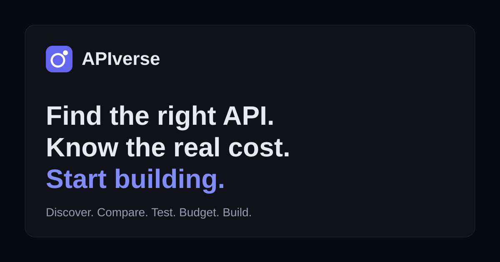

# APIverse

[](https://github.com/VivekSolanki1502/APIVERSE/actions/workflows/ci.yml) [](LICENSE) [](https://nodejs.org/)

**Discover. Compare. Test. Budget. Build.**

APIverse is an open-source web app for choosing APIs before integrating them. The React frontend supports discovery, pricing comparisons, cost estimates and browser-side request testing. The repo includes a free Cloudflare deployment setup for the app, with public collection links, API suggestions and correction reports backed by persistent D1 storage. A Fastify/SQLite backend is also included for local development and self-hosting.

Its differentiator is not catalog size. It is **trustworthy data and honest uncertainty**: every pricing record carries a source URL, a verification status and a last-verified date, and unknown values stay unknown (never zero).

> **Live demo:** Coming soon. For now, run APIverse locally using the steps below.
>


## Features

| Route | What it does |
| --- | --- |
| `/` | Landing page built from real catalog entries |
| `/explore` | Full-text search; filters for category, auth, HTTPS, pricing model, free tier, verified pricing; sorting; pagination; shareable URLs |
| `/api/:id` | Details, auth, CORS status, pricing and limits, sources, request examples (cURL / JavaScript / Python), report-outdated link |
| `/budget-finder` | Requirement-based ranking with a reason for every result, a separate "review needed" list for unverified pricing, and a cost calculator |
| `/compare` | Side-by-side comparison; flags pricing models that are not comparable |
| `/playground` | Browser-side GET requests, JSON tree viewer, error explanations, SSRF-style URL blocking |
| `/collections`, `/favorites` | Browser-only favorites and editable collections, JSON export/import, local share links, and optional public online shares |
| `/contribute`, `/about`, `/privacy` | Project information |

## Honest limitations

- **Catalog is small and mostly unreviewed.** Only entries whose pricing was checked against official pages are marked `verified` (see the `lastVerified` date and `verificationNotes` on each). All others are `needs-review` and are never shown as confirmed free/cheap options.
- **Verification is manual.** There is no automated price monitoring and no price-alert system.
- **CORS is `unknown`** unless tested. Many providers block browser calls; the playground says so instead of faking results.
- Favorites and personal collections stay in the browser. Online collection links, API suggestions and correction reports use the optional backend.
- The backend has no user accounts or admin interface. Public submissions and reports are stored for maintainer review; shared collections are readable by anyone with the link.
- Cost estimates are not bills (taxes, exchange rates, rounding and provider changes are not included).

## Budget Finder

`/budget-finder` helps you pick an API that fits your project and budget. Every input is optional: category, keywords, authentication preference, expected monthly requests, maximum monthly budget, currency, and whether you accept paid plans, free trials and self-hosted software.

- Results come from real catalog metadata and are ranked by a **transparent score**: functional match, budget fit, authentication complexity, documentation, known limitations and verification freshness. "Why this result" lists the reasons and warnings behind each score.
- Pricing is classified into distinct categories: free with no scheduled expiry, limited free tier, free trial/credits, freemium, paid, and self-hosted. A trial is never called free forever, and self-hosted software is never treated as zero-cost (hosting and maintenance still cost money).
- Entries without verified pricing appear in a separate **review needed** list, never as confirmed free or cheap options.
- It never claims something is "the cheapest". Assumptions are shown on the page.

### Cost estimation limitations

- Estimates are **not bills**. Taxes, exchange rates, rounding rules, provider changes and other charges may not be included.
- Each billing model has its own calculator (requests, credits, tokens, tiered requests, data volume, per-user). Token pricing requires input and output token assumptions, not just a request count.
- If a price or quota is missing, the result is "Cannot estimate reliably". It is never filled in as zero.
- Block rounding (for example, billed per 1,000 requests) is applied only when the plan says the provider does that.
- Currency is shown as recorded; there is no exchange-rate conversion.
- Only plans recorded in the catalog can be estimated, and currently few entries have plan data.

## Tech stack

React 18 · TypeScript (strict) · Vite · Tailwind CSS · React Router · Fastify · SQLite (`node:sqlite`) · Vitest · GitHub Actions. No paid service is required.

## Getting started

Requirements: Node.js 22.13+ and npm.

```bash
git clone https://github.com/VivekSolanki1502/APIVERSE.git apiverse
cd apiverse
npm ci
npm run backend:dev  # terminal 1, API at http://127.0.0.1:3001
npm run dev          # terminal 2, frontend at http://localhost:5173
```

Vite proxies backend routes to `127.0.0.1:3001` during development. The backend uses `backend/data/apiverse.sqlite` by default; set `DATABASE_PATH` to use a persistent volume in deployment. The backend checks the catalog at startup and refuses to serve invalid data.

### Scripts

| Command | Purpose |
| --- | --- |
| `npm run dev` | Dev server |
| `npm run build` | Type-check, build to `dist/`, write `404.html` SPA fallback |
| `npm run preview` | Serve the production build locally |
| `npm run lint` / `npm run format` | ESLint / Prettier |
| `npm run typecheck` | `tsc --noEmit` |
| `npm run validate:catalog` | Validate `src/data/catalog.json` (non-zero exit on errors) |
| `npm test` | Unit tests (Vitest) |
| `npm run check` | Everything CI runs |
| `npm run backend:dev` | Start the API server in watch mode |
| `npm run backend:typecheck` | Type-check backend code |
| `npm run test:backend` | Run HTTP integration tests against an in-memory database |
| `npm run backend:build` | Bundle the API server to `dist-backend/` |
| `npm run backend:start` | Start the bundled API server |

## Project layout

```
src/
  data/catalog.json      # the version-controlled catalog (schemaVersion 1)
  types/catalog.ts       # strict catalog types and enums
  lib/                   # pure, tested logic: search, cost, budget, request safety, examples, collections
  hooks/                 # theme, local data stores, clipboard
  components/ pages/     # UI
scripts/                 # catalog validator, link checker, postbuild
backend/
  src/                    # Fastify routes, catalog loader, SQLite persistence
  tests/                  # HTTP integration tests
docs/                    # architecture, adding an API, pricing verification, deployment
```

## Catalog schema

Defined in [`src/types/catalog.ts`](src/types/catalog.ts) and enforced by [`src/lib/validateCatalog.ts`](src/lib/validateCatalog.ts). Each entry has identity fields (`id`, `name`, `description`, `category`, `tags`), URLs (`baseUrl`, `documentationUrl`, `officialWebsiteUrl`, `statusPageUrl`), `authentication`, `https`, `corsStatus`, a structured `pricing` object (model, free tier, trial, plans with explicit billing rules, rate limits, overage policy, currency, official pricing/terms URLs, `lastVerified`, `verificationStatus`, `verificationNotes`, `history`), `sampleRequest`, `limitations`, `featured` and `addedOn`. The validator rejects duplicate ids, bad URLs and dates, invalid enums, contradictory pricing labels, verified entries lacking evidence, and credential-looking sample values. Guides: [adding an API](docs/adding-an-api.md), [pricing verification](docs/pricing-verification.md), [architecture](docs/architecture.md).

## Testing

```bash
npm run validate:catalog   # catalog schema and data rules (exits non-zero on error)
npm test                   # Vitest
npm run test:backend       # backend HTTP integration tests
npm run check              # lint, type checks, validation, tests, and frontend/backend builds
```

Unit tests cover the catalog validator, search and combined filters, sorting, URL state, budget ranking, every billing calculator, unknown-price handling, trial and unverified labelling, currency display, request safety and error handling (including that failures never produce fake successful responses), local persistence, collection import/export, and generated code examples.
Backend integration tests cover health/readiness, OpenAPI, catalog search, validation errors, persistent online collections, submissions, reports and pricing/recommendation routes.

**Not yet tested:** React component rendering, routing and direct-URL navigation, mobile layout, and full browser workflows between the UI and backend. These need React Testing Library and a browser run (for example Playwright). Contributions welcome.

## Roadmap

- [x] Phase 1: catalog, search and filters, detail pages, pricing labels and sources, favorites
- [x] Phase 2: Budget Finder, cost calculators, comparison, unverified-pricing warnings
- [x] Phase 3: playground (GET only), response viewer, error explanations, examples, security controls
- [x] Phase 4: contribution docs, catalog validation, CI, collection import/export and share links, deployment docs
- [ ] Verify the remaining `needs-review` entries against official sources
- [ ] Component, routing and end-to-end tests
- [ ] Phase 5 ideas: use-case collections, project starter examples, better recommendations, community-maintained verification, optional pricing-change monitoring (only with review of changes), optional AI-assisted explanations (never required for core features)

"Checked" means the code is written and has the tests listed above. See the status note under Getting started for what has not been run yet.

## Known limitations

- Most catalog entries are unverified; the catalog is small.
- No automated pricing monitoring or alerts.
- CORS for third-party APIs is unknown unless tested; some APIs cannot be called from the browser playground.
- The backend is a small single-process SQLite service. Deploy it with a persistent disk and configure `CORS_ORIGINS` and `VITE_API_BASE_URL` for your frontend/API origins.
- Online shares are public to anyone with the share link. Reports and suggestions are stored for review; no moderation dashboard is included.
- Playground supports GET only. Hostnames that resolve to private addresses via DNS cannot be detected client-side, but requests come from the user's own browser, not a server.
- Favorites and collections are per-browser and are lost if site data is cleared.
- Share links are not private or encrypted.
- Third-party hosting free tiers can change; check current terms before deploying.

## Security

Report vulnerabilities privately, see [SECURITY.md](SECURITY.md). Do not open public issues for security problems.

## Contributing

Adding or correcting an API is a JSON edit plus a pull request. Read [CONTRIBUTING.md](CONTRIBUTING.md) and [docs/pricing-verification.md](docs/pricing-verification.md). Please report vulnerabilities privately, see [SECURITY.md](SECURITY.md).

## Deployment

The frontend can use static hosting. The optional API needs a separate Node service and persistent disk. See [docs/deployment.md](docs/deployment.md) for setup details. Check each host's current limits before relying on them.

## License

[MIT](LICENSE)
